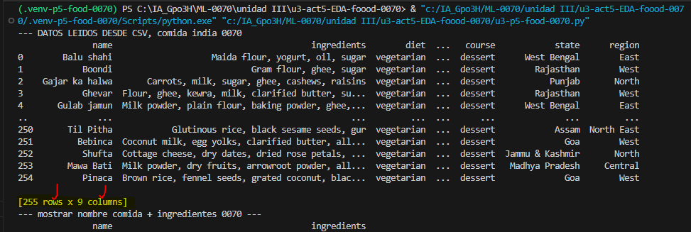
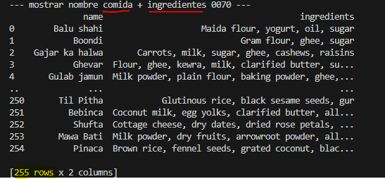
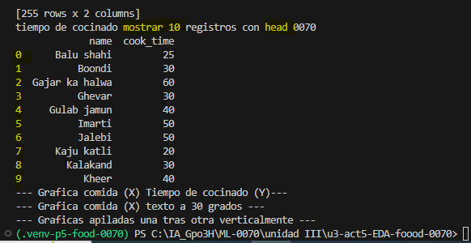
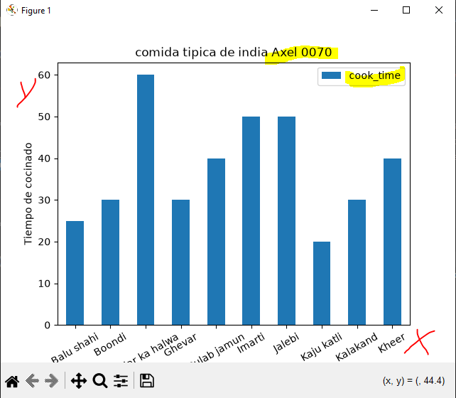
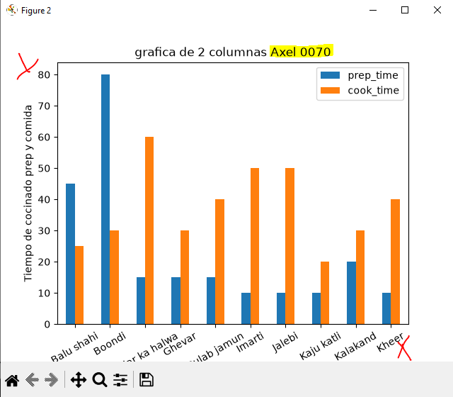
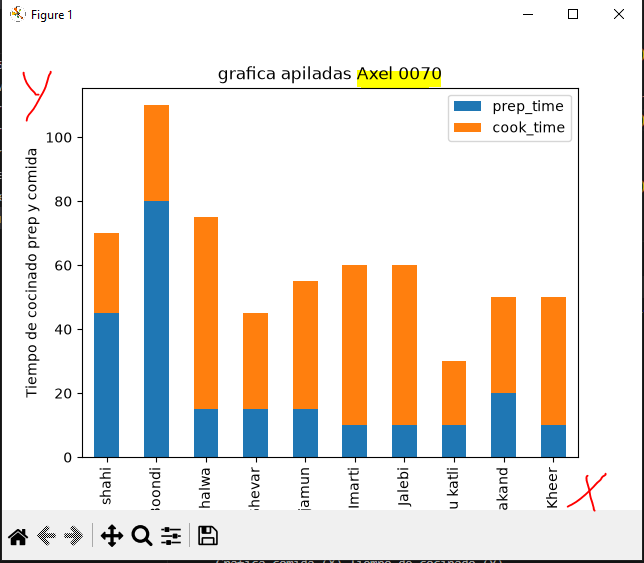

## analisis explotatorio de datos
## comida del pais india
## Axel Guzman NC 0070
### +-+-+ importando datos del archivo csv comida de india +-+-+-

## +-+-+ mostrar nombre + ingredientes

### tiempo de cocinado mostrar 10 registros con head

## creacion de grafica

## grafica de varias columnas

## grafica apilada
